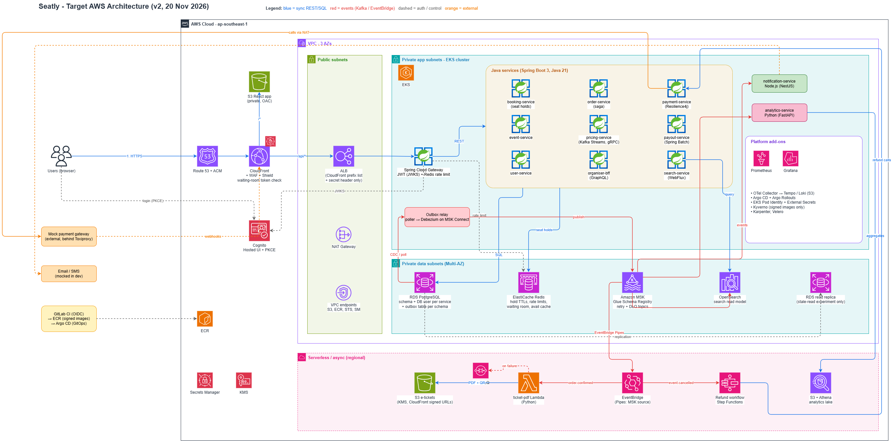

# 🎟️ Seatly

A ticket booking platform for events (concerts, conferences, workshops), built as a **learning lab**.
It has 11 microservices (9 Java, 1 Python, 1 Node.js) on AWS EKS, plus Lambda and Step Functions,
and runs as an internal developer platform.

Every hard part of ticketing (flash-sale spikes, two users competing for one seat, slow payments)
maps to a pattern to test, and every experiment starts with a written hypothesis.

## Architecture at a glance



*Target AWS architecture — see the editable [Draw.io source](docs/architecture/Seatly-v1.drawio).*

- **Edge:** Route 53 and ACM route users to CloudFront, AWS WAF, Shield and the private S3 React application. `/api/*` requests pass through CloudFront to an ALB and Spring Cloud Gateway.
- **Identity and ingress:** Cognito provides Hosted UI authentication with PKCE; the gateway validates JWTs using Cognito JWKS and applies Redis-backed rate and waiting-room controls.
- **Application:** A private-subnet EKS cluster runs nine Java services, plus the NestJS notification service and FastAPI analytics service. REST and SQL are synchronous; Kafka carries asynchronous state changes.
- **Data:** RDS PostgreSQL uses a schema and database user per service, ElastiCache Redis stores holds and caches, OpenSearch provides event search, and an RDS read replica supports analytics experiments.
- **Events:** A transactional outbox relay publishes changes through Debezium on MSK Connect into Amazon MSK. EventBridge Pipes sends selected events to serverless workflows.
- **Serverless:** Lambda generates ticket PDFs in S3 with CloudFront signed URLs and a DLQ. Step Functions runs refund workflows; an S3 and Athena analytics lake receives aggregated data.
- **Platform and delivery:** GitLab CI uses OIDC to publish signed images to ECR and Argo CD deploys GitOps releases. EKS includes Argo Rollouts, External Secrets, Kyverno, Karpenter, Velero, Prometheus, Grafana and OpenTelemetry.

See [docs/architecture/system-design.md](docs/architecture/system-design.md) for the full design.

## Repository layout

| Path | Contents |
|---|---|
| `docs/` | System design, ADRs, API and event contracts, experiments, runbooks (published with MkDocs) |
| `services/` | One folder per microservice |
| `frontend/` | React + TypeScript customer app and organiser portal |
| `infra/` | Terraform: `modules/`, `envs/dev`, `envs/prod`, `bootstrap/` |
| `platform/` | Backstage templates and cluster add-ons |
| `deploy/` | Helm chart and Argo CD app-of-apps |
| `load-tests/` | k6 scripts |

## Docs

```bash
make docs-serve     # live preview at http://127.0.0.1:8000
make docs-build     # strict build (fails on broken links)
make lint-contracts # validate OpenAPI and AsyncAPI specs
```

The docs are published to GitLab Pages on every merge to `main`. The same MkDocs setup works as
Backstage TechDocs (`catalog-info.yaml`).

## Key docs

- [System design](docs/architecture/system-design.md)
- [Architecture Decision Records](docs/adr/README.md)
- [Experiments](docs/experiments/README.md)
- [API contracts](docs/api/README.md) · [Event contracts](docs/events/README.md)
