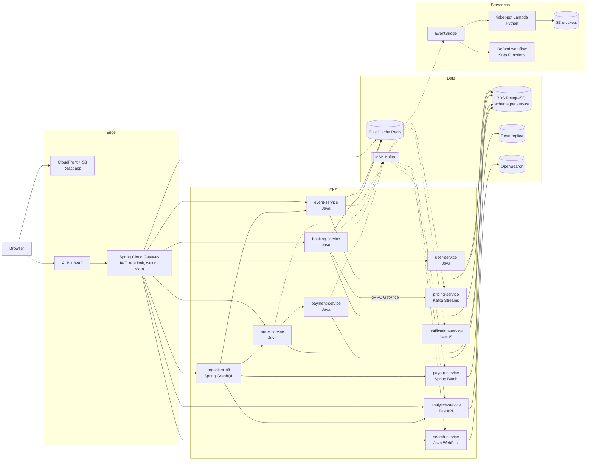

# C4 Level 2 – Containers

Deployable units and how they talk. Solid lines are synchronous (REST/gRPC/GraphQL); dotted lines
are asynchronous (Kafka / EventBridge).

## Notes

- Each service owns its schema. No cross-schema joins (see the rules in the
  [system design](../system-design.md#rules)).
- Every Kafka event leaves through the service's `outbox` table
  ([ADR-0003](../../adr/0003-transactional-outbox.md)).
- Lambda and Step Functions are outside EKS and only see events bridged through EventBridge.
