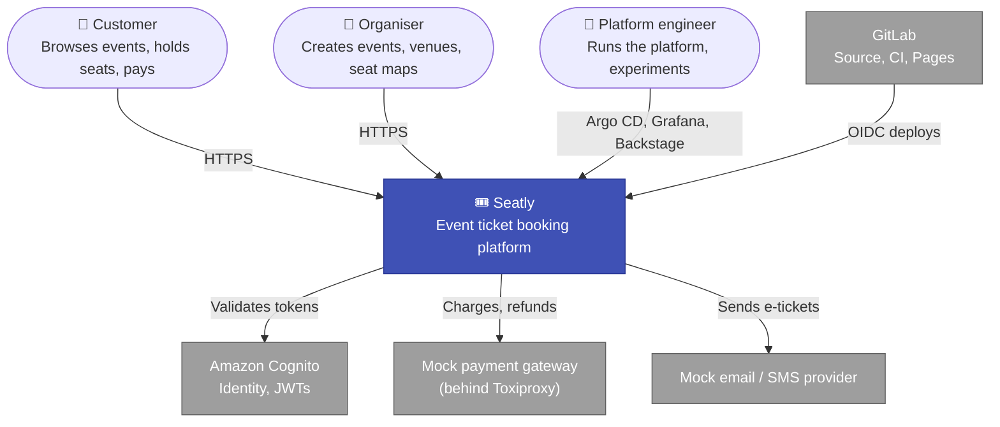

# C4 Level 1 – System context

Who uses Seatly and which external systems it depends on.

| Actor / system | Notes |
|---|---|
| Customer | Uses the React web app (no mobile, see scope limits) |
| Organiser | Uses the organiser portal, served through `organiser-bff` (GraphQL) |
| Mock payment gateway | Its own container so latency and errors can be injected |
| Cognito | May be replaced by Keycloak, see [ADR-0006](../../adr/0006-identity-provider.md) |
