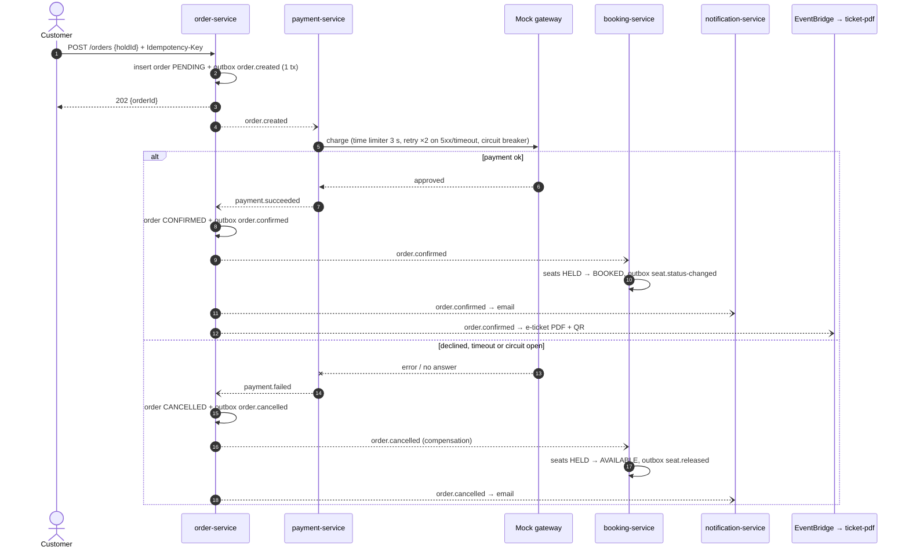

# Flow – Booking saga (choreography)

Starts from a confirmed hold. Choreography first, see [ADR-0004](../../adr/0004-saga-style.md).
Every step is idempotent (`processed_events` table), so Kafka redelivery is safe.

## Resilience settings (payment-service → gateway)

| Pattern | Setting | Why |
|---|---|---|
| Time limiter | 3 s | Customer is waiting; a slow gateway must not pin threads |
| Retry | 2 attempts, only 5xx and timeouts | 4xx (declined card) is a business answer, not a fault |
| Circuit breaker | 50% failures over 20 calls, 5 s open | Fail fast so compensation runs instead of queuing |
| Bulkhead | Separate pool for gateway calls | Gateway trouble must not starve other endpoints |

## Failure cases to test

- payment-service killed mid-saga → hold TTL still releases seats (Phase 6 experiment).
- Duplicate `payment.succeeded` delivery → order stays CONFIRMED once, one email.
- Gateway charges but the response is lost → payment idempotency key prevents a double charge on retry.
