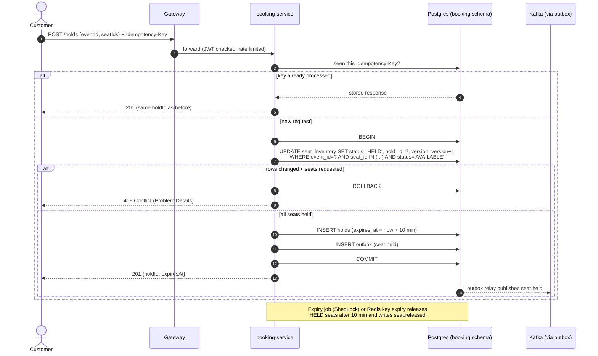

# Flow – Seat hold

All-or-nothing seat hold with a 10-minute TTL. Locking strategy is decided by
[ADR-0002](../../adr/0002-seat-locking-strategy.md) and measured in
[EXP-001](../../experiments/EXP-001-seat-locking.md).

## Invariants

- No partial holds: the number of changed rows must equal the number of seats requested.
- `PK (event_id, seat_id)` and the `status='AVAILABLE'` condition make an oversell impossible at the
  database level, whatever the application does.
- The outbox row commits with the state change, so an event is never lost or published for a
  rolled-back change.
