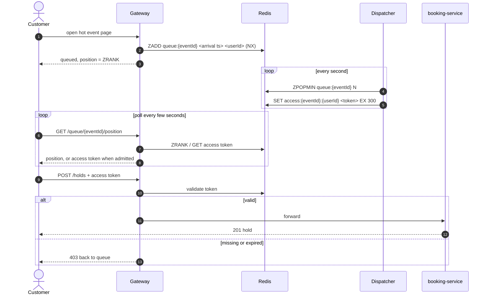

# Flow – Flash-sale waiting room

Protects booking-service when a hot event opens. N (users admitted per second) is tuned in the
Phase 10 load test until booking-service p99 stays under target.

## Open points

- Fairness: is re-joining after a token expiry allowed? At the back of the queue or the front?
- Bots: WAF rate rules plus per-user tokens; measure how many duplicate joins `NX` blocks.
