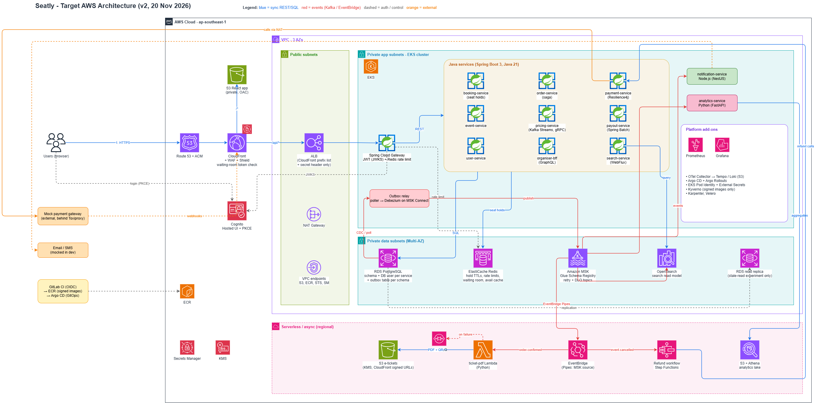

# Event Ticket Booking Platform – System Design

!!! info "Source"
    Migrated from the Notion page "Seatly" on 2026-11-20. This file is now the source of truth;
    change it through merge requests.

A ticket booking platform for events (concerts, conferences, workshops), built as 11 microservices
(9 Java, plus Python and Node.js) on AWS EKS plus Lambda and Step Functions, run as an internal
developer platform. It is designed as a learning lab: every hard part of ticketing (flash-sale
spikes, two users competing for one seat, slow payments) maps to a pattern worth testing.

## Overview

### What users can do

- Browse events and see live seat availability
- Hold seats for 10 minutes, pay, and get an e-ticket by email
- Organisers create events, venues and seat maps

### Learning goals

- Resilience4j: circuit breaker, retry, time limiter, bulkhead, rate limiter
- Kafka with the outbox pattern, saga (choreography, then orchestration), CQRS
- Concurrency control under load, caching, idempotency
- Terraform on AWS, EKS operations, observability, chaos testing

### Scope limits (to keep it buildable)

- Payments and email/SMS are mocked; no real money moves
- One region, one currency, a single React web app (no mobile)
- Every experiment starts with a written hypothesis and a Grafana panel that proves or disproves it

## Coverage check: GovTech role, platform engineering, learning goals

The first draft covered Java microservices, AWS and Kubernetes well but missed 4 of the GovTech JD's
key skills (Python, Node.js, Lambda, Step Functions) and most platform-engineering topics. The
sections below now include them.

### GovTech (URA) role — JD skills and how GovTech works

| Requirement | Where the project covers it |
| --- | --- |
| ReactJS | Customer web app + organiser portal (React, TypeScript) |
| Python | analytics-service (FastAPI, Kafka consumer) and Python Lambdas |
| Node.js | notification-service in Node.js/TypeScript (NestJS) |
| AWS Lambda | E-ticket PDF + QR generation; refund steps |
| AWS Step Functions | Event-cancellation refund workflow (Map state over all orders, retries, wait for payment callback) |
| EKS, Docker, Kubernetes | Core platform for all services |
| GitOps / Argo CD | Argo CD app-of-apps, Argo Rollouts canaries |
| GitLab CI | Pipelines in GitLab CI, because GovTech's [SHIP-HATS](https://www.developer.tech.gov.sg/products/categories/devops/ship-hats/overview.html) is GitLab-based |
| DevSecOps, compliance | SAST, dependency and image scanning, SBOM, signed images, policy-as-code; controls mapped to [IM8 / ICT&SS policy](https://github.com/GovTechSG/tech-standards) themes (encryption, least privilege, logging, vulnerability management) |
| Terraform | All AWS infrastructure, with reusable modules |

### Platform engineering

| Topic | Added as |
| --- | --- |
| Internal developer platform | Backstage with a software catalog of all services and TechDocs |
| Golden paths | Backstage templates that create a new Spring Boot or Python service with repo, CI, Helm chart, dashboards and alerts in one click |
| Self-service infrastructure | Crossplane (or Terraform modules behind templates) so a team requests a database or queue through Git |
| Multi-tenancy | Namespace per team with RBAC, ResourceQuota, LimitRange, NetworkPolicy |
| Policy as code | Kyverno (or OPA Gatekeeper) in cluster; Conftest/Checkov on Terraform |
| Supply chain security | Trivy, Syft SBOM, cosign signing, Kyverno verifies signatures |
| Service mesh | Istio or Linkerd: mTLS, traffic splitting, retries at mesh level vs Resilience4j |
| SLOs and on-call | SLOs with error budgets (Sloth or Pyrra), alert routing, runbooks, postmortems |
| Cluster operations (CKA) | EKS version upgrades, node rotation, Velero backup and restore, DR drill |
| Cost (FinOps) | Kubecost or OpenCost per namespace, Spot, rightsizing |
| Platform metrics | DORA metrics from pipelines |

### Learning goals (detail)

- **Distributed systems:** Kafka partitions, consumer groups and exactly-once, Postgres read
  replicas and replication lag, Redis cluster, idempotency, ordering. One experiment shows a stale
  read from a replica and how to handle it.
- **CKAD/CKA:** workloads, probes, Helm, Kustomize, RBAC (CKAD); upgrades, etcd/backup concepts,
  networking, troubleshooting (CKA, practised on kind since EKS hides the control plane).
- **Terraform Associate:** modules, state, workspaces vs directories, import, drift.
- **AI/ML (optional):** an organiser assistant on Bedrock with RAG over event FAQs, deployed
  through the same golden path.

### Order for the 21 Dec start date

Phases 1–3 build the base locally, then Phases 4–5 cover the skills the GovTech JD lists as
essential (Terraform, EKS, Argo CD, GitLab CI, Lambda, Step Functions, Python) before the deeper
microservice and platform phases.

## Architecture



The [editable Draw.io diagram](Seatly-v1.drawio), [system context](c4/context.md), and
[container view](c4/containers.md) show the deployable design.

The browser loads the React app from private S3 through CloudFront and sends API calls through an
ALB to Spring Cloud Gateway. The gateway validates Cognito JWTs with JWKS and uses Redis for rate,
waiting-room, hold and availability controls. Nine Java services run in the private EKS subnets with
Node.js notification and Python analytics services.

RDS PostgreSQL gives each service a separate schema and database identity. ElastiCache Redis, Amazon
MSK and OpenSearch provide low-latency state, event streaming and search read models. An outbox relay
poller advances to Debezium on MSK Connect for change-data capture, and MSK publishes state changes
for notifications, analytics and search.

EventBridge Pipes bridges selected Kafka events to serverless workflows: Lambda generates ticket PDFs
and stores them in S3, while Step Functions compensates cancelled events through refund workflows.
GitLab CI publishes signed images to ECR through OIDC, Argo CD handles GitOps delivery, and EKS
platform add-ons provide observability, policy, autoscaling and disaster recovery.

## Services

Eleven services (nine in Java, one Python, one Node.js) plus two serverless workflows, each service
with its own Postgres schema. Reads and commands go over REST through the gateway; state changes go
out as Kafka events through an outbox table.

| Service | Language | Owns | Sync API (examples) | Publishes | Consumes | Main experiments |
| --- | --- | --- | --- | --- | --- | --- |
| user-service | Java | Users, roles, organiser profiles | `POST /auth/login`, `GET /users/me` | `user.registered` | — | Cognito/JWT at the gateway, per-user rate limits |
| event-service | Java | Events, venues, seat maps, prices | `GET /events`, `GET /events/{id}/seats` | `event.published`, `event.updated`, `event.cancelled` | `seat.status-changed` | Redis cache-aside, CQRS availability view, thundering herd |
| booking-service | Java | Seat holds, reservations | `POST /holds`, `DELETE /holds/{id}` | `seat.held`, `seat.released`, `seat.status-changed` | `order.confirmed`, `order.cancelled` | Locking strategies, idempotency keys, hold TTL expiry |
| order-service | Java | Orders, saga state | `POST /orders`, `GET /orders/{id}` | `order.created`, `order.confirmed`, `order.cancelled` | `payment.succeeded`, `payment.failed` | Saga, outbox, compensation, Spring State Machine |
| payment-service | Java | Payments, refunds (mock gateway) | `POST /payments`, `POST /refunds` (idempotent) | `payment.succeeded`, `payment.failed`, `refund.completed` | `order.created` | Circuit breaker, retry, time limiter, bulkhead |
| search-service | Java (WebFlux) | Search index of events in OpenSearch | `GET /search?q=` (reactive) | — | `event.*` | Reactive streams, back-pressure, R2DBC vs JDBC |
| pricing-service | Java (Kafka Streams) | Demand-based price tiers | gRPC `GetPrice` | `price.changed` | `seat.status` | Kafka Streams windows, state stores, interactive queries, gRPC |
| payout-service | Java (Spring Batch) | Organiser settlements | `POST /payouts/run` (admin) | `payout.completed` | `order.confirmed`, `refund.completed` | Chunked, restartable batch jobs, partitioning, ShedLock |
| organiser-bff | Java (Spring GraphQL) | Nothing (aggregates other services) | `/graphql` | — | — | GraphQL, DataLoader for N+1, HTTP interface clients, structured concurrency fan-out |
| notification-service | Node.js (NestJS) | Templates, delivery log | none (internal only) | — | `order.confirmed`, `order.cancelled`, `user.registered` | Consumer retries, dead-letter topic, back-pressure |
| analytics-service | Python (FastAPI) | Sales and attendance stats | `GET /events/{id}/stats` | — | `order.*`, `seat.status` | Stream aggregation, read replica, stale-read experiment |
| ticket-pdf (Lambda) | Python | E-ticket PDF + QR in S3 | none (S3/EventBridge trigger) | `ticket.generated` | `order.confirmed` via EventBridge | Cold starts, concurrency limits, SQS DLQ |
| refund workflow (Step Functions) | Python Lambdas | Refund run per cancelled event | started by `event.cancelled` | `refund.completed` | — | Map state over orders, retries, wait for callback, idempotency |

### Rules

- No service reads another service's tables. Cross-service data comes from an API call or a local
  copy built from events.
- Every write endpoint accepts an `Idempotency-Key` header.
- The mock payment gateway runs as its own small container so Toxiproxy can add latency and errors
  in front of it.

### Java concepts map

Each Java service is built to teach something specific, so no two services repeat the same Java
lesson.

| Concept | Where you learn it |
| --- | --- |
| Records, sealed interfaces, pattern matching for `switch` | Domain events and saga states in order-service (`sealed interface OrderEvent permits ...`) |
| Virtual threads | booking-service and payment-service; compare against a platform-thread pool under k6 load |
| Structured concurrency, scoped values | organiser-bff fans out to 4 services per request (check the preview status in your Java version) |
| Reactive programming (Reactor, WebFlux, R2DBC) | search-service and Spring Cloud Gateway |
| Kafka Streams | pricing-service: windowed demand counts, state stores, interactive queries |
| gRPC + Protobuf | booking-service → pricing-service |
| Spring Batch | payout-service: chunk processing, restart after failure, partitioned steps |
| Spring GraphQL | organiser-bff, with DataLoader to fix N+1 calls |
| Spring State Machine | order-service saga states (then compare with plain sealed types) |
| Spring Security (OAuth2 resource server, method security) | every service; organiser vs customer roles |
| Spring Boot 3 HTTP clients (`RestClient`, HTTP interfaces), Problem Details (RFC 9457) | all service-to-service REST calls and error responses |
| Spring Modulith | booking-service as a modular monolith first, split later |
| JPA performance (N+1, batching, projections), jOOQ comparison | event-service seat-map queries |
| Caching (Spring Cache + Redis), scheduling with ShedLock | event-service, booking-service hold expiry |
| GraalVM native image, CRaC | user-service and search-service: compare startup time and memory against the JVM |
| JVM tuning: JFR, GC choice (G1 vs ZGC), JMH benchmarks | booking-service hot path during the flash-sale test |
| Testing: Testcontainers, ArchUnit, Pact, Spring Cloud Contract | all Java services |
| Spring AI (optional) | organiser assistant in Phase 11 |

Search-service and pricing-service land in Phase 7, payout-service and organiser-bff in Phase 6.

## Key flows

Three flows carry almost every experiment. Each has its own sequence diagram:

1. [Seat hold](sequence/seat-hold.md): one conditional `UPDATE`, all-or-nothing, outbox in the same transaction.
2. [Booking saga](sequence/booking-saga.md): every step is idempotent, so Kafka redelivery is safe.
   payment-service wraps the gateway call in a time limiter (3 s), retry (2 attempts, only on 5xx
   and timeouts) and a circuit breaker (50% failure rate over 20 calls, 5 s open). An open circuit
   fails the payment fast, which triggers compensation instead of hanging threads.
3. [Flash-sale waiting room](sequence/waiting-room.md): Redis sorted-set queue with a dispatcher
   that admits N users per second.

## Data model

One RDS PostgreSQL instance with a schema per service. The `seat_inventory` table in
booking-service is where concurrency matters most.

### Core tables

| Service | Table | Key columns |
| --- | --- | --- |
| event | `events` | id, venue_id, name, starts_at, status (DRAFT, PUBLISHED, CANCELLED) |
| event | `venues`, `sections`, `seats` | seat_id, section_id, row_label, seat_no, price_tier |
| booking | `seat_inventory` | event_id, seat_id, status (AVAILABLE, HELD, BOOKED), hold_id, version; PK (event_id, seat_id) |
| booking | `holds` | id, user_id, event_id, seat_ids, expires_at, status |
| order | `orders` | id, user_id, hold_id, total, status (PENDING, PAID, CONFIRMED, CANCELLED), saga_step |
| payment | `payments` | id, order_id, idempotency_key (unique), amount, status, attempts |
| all | `outbox` | id, aggregate_type, aggregate_id, event_type, payload (jsonb), created_at, published_at |
| all | `processed_events` | event_id, consumer, processed_at (for idempotent consumers) |

### Redis keys (ElastiCache)

- `event:{id}` — cached event details, TTL 10 min with jitter
- `avail:{eventId}` — hash of seat_id → status, updated from `seat.status-changed` (the CQRS read model)
- `lock:seat:{eventId}:{seatId}` — `SET NX PX 10000`, used only in the Redis-lock experiment
- `queue:{eventId}` — sorted set for the flash-sale waiting room
- `ratelimit:{userId}` — token bucket at the gateway

### Kafka topics (MSK)

| Topic | Partition key | Producers | Consumers |
| --- | --- | --- | --- |
| `event.lifecycle` | eventId | event | booking |
| `seat.status` | eventId | booking | event |
| `order.lifecycle` | orderId | order | booking, payment, notification |
| `payment.result` | orderId | payment | order |
| `*.dlt` | same as source | consumers on failure | ops / replay tool |

Partition by aggregate id so all events for one order or one event arrive in order. The contracts
live in [`docs/events/asyncapi.yaml`](../events/README.md).

## AWS and Terraform

Run everything locally (Docker Compose, then kind) for daily work, and spin up AWS only for cloud
experiments. Terraform must be able to destroy and recreate the whole environment in under
30 minutes, so the AWS bill only runs while you are testing.

### AWS resources

| Layer | Service | Notes |
| --- | --- | --- |
| Frontend | S3 + CloudFront | React build, OAC so the bucket stays private |
| Edge | Route 53, ACM, AWS WAF | WAF rate rules are a second rate-limit layer |
| Auth | Cognito user pool | Issues JWTs; the gateway validates them |
| Ingress | ALB via AWS Load Balancer Controller | One ALB for all services through Ingress |
| Compute | EKS (managed node groups, Spot for dev) | Karpenter later for the autoscaling experiments |
| Serverless | Lambda (Python), Step Functions, EventBridge, SQS | Ticket PDFs, refund workflow; Kafka events bridged to EventBridge via a small connector or EventBridge Pipes |
| Database | RDS PostgreSQL + one read replica (Multi-AZ off in dev) | Schema per service; analytics-service reads the replica |
| Cache | ElastiCache Redis | Availability read model, locks, waiting room |
| Messaging | Amazon MSK (Serverless for dev) | Kafka topics above |
| Storage | S3 | E-tickets, Velero backups, Terraform state |
| Images | ECR (scan on push) | One repository per service; images signed with cosign |
| Observability | Self-hosted kube-prometheus-stack, Tempo, Loki; ADOT collector; CloudWatch for Lambda | Cheaper than managed for a lab |
| Security | Secrets Manager + External Secrets, KMS, GuardDuty, Security Hub, AWS Config | Evidence for the IM8-style controls |
| CI/CD | GitLab CI (OIDC to AWS), Argo CD on EKS | Mirrors GovTech's GitLab-based SHIP-HATS |

### Terraform layout

```text
infra/
  modules/
    network/        # VPC, 3 AZs, public + private subnets, NAT
    eks/            # cluster, node groups, IRSA, add-ons
    rds/
    elasticache/
    msk/
    cognito/
    frontend/       # S3, CloudFront, ACM, Route 53
    observability/
  envs/
    dev/            # main.tf, terraform.tfvars, backend.tf
    prod/
  bootstrap/        # S3 state bucket + DynamoDB lock table
```

- Remote state in S3 with DynamoDB locking; one state file per environment
- Kubernetes add-ons and app deployments are not in Terraform: Terraform builds the platform, then
  Argo CD deploys the apps (app-of-apps pattern)
- Use IRSA (or EKS Pod Identity) so each service gets its own IAM role
- Run `tflint`, `checkov` and `terraform plan` in CI on every merge request

### Cost control

- The EKS control plane alone is about $73 a month, and NAT gateways, RDS and MSK add up quickly.
  Destroy dev when you are not testing
- One NAT gateway in dev, Spot nodes, smallest RDS and Redis sizes
- Add an AWS Budgets alert before the first `terraform apply`

## Tech stack

| Area | Choice | Why |
| --- | --- | --- |
| Java services | Java 21, Spring Boot 3.x, virtual threads | Current LTS; virtual threads make the bulkhead experiments interesting |
| Python | FastAPI, aiokafka, Pydantic, pytest; Lambda Powertools | Covers the GovTech JD's Python requirement |
| Node.js | NestJS (TypeScript), kafkajs, Jest | Covers the JD's Node.js requirement |
| Gateway | Spring Cloud Gateway | JWT validation, Redis rate limiter, routing |
| Resilience | Resilience4j (Spring Boot 3 starter) | Metrics go straight to Micrometer |
| Messaging | Spring Kafka, outbox poller (Debezium later) | Start simple, then compare with CDC |
| Persistence | Spring Data JPA, Flyway, PostgreSQL | One migration set per service |
| API contracts | OpenAPI 3, AsyncAPI + JSON Schema for events | Contract tests across three languages |
| Frontend | React + TypeScript, Vite, TanStack Query, Tailwind | Customer app and organiser portal; seat map as SVG |
| Observability | OpenTelemetry SDKs in all languages, Prometheus, Grafana, Tempo, Loki | One trace across Java, Python, Node and Lambda |
| Testing | JUnit 5, pytest, Jest, Testcontainers, Pact, k6 | Real dependencies in integration tests |
| Chaos | Toxiproxy locally, Chaos Mesh or AWS FIS on EKS | Latency, errors, pod kills, AZ failure |
| CI/CD | GitLab CI (OIDC to AWS), Argo CD, Argo Rollouts | Same tools as GovTech's SHIP-HATS + GitOps |
| Security | Semgrep (SAST), Trivy, Syft (SBOM), cosign, Kyverno, Checkov/Conftest | Shift-left DevSecOps |
| Platform | Backstage, Crossplane, Istio or Linkerd, Karpenter, Velero, Kubecost, Sloth | The internal developer platform layer |
| Repo | Monorepo: `services/*`, `frontend/`, `infra/`, `platform/`, `deploy/`, `load-tests/` | `platform/` holds Backstage templates and cluster add-ons ([ADR-0001](../adr/0001-monorepo.md)) |

### Rules

- Every service exposes `/actuator/health/{liveness,readiness}` and `/actuator/prometheus` (or the
  equivalent in Python and Node)
- Structured JSON logs with `traceId`; one shared Helm chart with per-service values
- A merge request must pass unit tests, Testcontainers tests and contract tests before merge

## Build phases

Each phase ends with something that runs and one experiment that is written up. Don't start a phase
until the previous one's exit check passes.

1. **Foundation (local).** Monorepo, Docker Compose with Postgres, Redis, Kafka, Prometheus, Grafana
   and Tempo. event-service and booking-service with REST only.
    - Exit check: book a seat end to end and see the trace in Tempo.
2. **Concurrency.** Seat holds with a TTL, idempotency keys, k6 test with 1,000 users competing for
   100 seats.
    - Experiment: row lock vs optimistic `version` vs Redis `SET NX`. Compare oversells (must be 0),
      p99 latency and throughput. → [EXP-001](../experiments/EXP-001-seat-locking.md)
3. **Payments and resilience.** order-service, payment-service and the mock gateway behind
   Toxiproxy. Add Resilience4j.
    - Experiment: circuit breaker + time limiter + retry with a slow or failing gateway. Show the
      state changes in Grafana.
4. **AWS, Terraform, GitLab CI, GitOps.** network, EKS, RDS, ElastiCache, MSK, Cognito and frontend
   modules; GitLab CI with OIDC; Argo CD app-of-apps.
    - Exit check: `terraform destroy` and `apply` from zero in under 30 minutes; a merge to main
      deploys through Argo CD with no manual step.
5. **Serverless and Python.** ticket-pdf Lambda, refund workflow in Step Functions,
   analytics-service in FastAPI.
    - Experiment: cancel an event with 5,000 orders; measure refund throughput, retries and Lambda
      concurrency limits.
6. **Events and saga.** Outbox, Kafka topics, choreography saga with seat release on payment
   failure, notification-service in NestJS with a dead-letter topic, payout-service (Spring Batch),
   organiser-bff (Spring GraphQL).
    - Experiment: kill payment-service halfway through a saga; confirm no seat stays held after its
      TTL.
7. **Read side and caching.** CQRS availability view in Redis, cache-aside for event pages, read
   replica for analytics, search-service (WebFlux + OpenSearch), pricing-service (Kafka Streams +
   gRPC), React UI with the seat map.
    - Experiments: thundering herd on a hot event (jittered TTL, request coalescing); stale reads
      from the replica.
8. **DevSecOps.** Semgrep, Trivy, SBOM, cosign signing, Kyverno policies, Checkov on Terraform,
   GuardDuty and Security Hub; a controls table mapped to IM8-style themes.
    - Exit check: an unsigned or critical-CVE image is blocked from the cluster.
9. **Internal developer platform.** Backstage catalog and TechDocs, golden-path templates for Spring
   Boot and FastAPI services, Crossplane self-service, namespace-per-team tenancy, service mesh with
   mTLS.
    - Exit check: a new service goes from template to running in dev with CI, dashboards and alerts
      in under 15 minutes.
10. **Scale, reliability and cost.** Waiting room, HPA/Karpenter, SLOs with error budgets, Chaos
    Mesh (pod kill, AZ failure), Velero DR drill, EKS version upgrade, Kubecost, DORA metrics.
    - Experiment: 10k-user flash sale; measure waiting-room fairness, scaling delay and error-budget
      burn.
11. **Advanced (optional).** Orchestrated saga vs choreography, Debezium CDC instead of the poller,
    canary releases with Argo Rollouts, an organiser assistant on Bedrock with RAG.

## Risks and open decisions

The biggest risk is spending months on features and infrastructure without running experiments.
The phase exit checks are there to prevent that.

| Risk | Effect | Mitigation |
| --- | --- | --- |
| Scope creep | Platform never reaches the interesting experiments | Freeze the features in Overview; new ideas go to Phase 11 |
| AWS cost | Monthly bill from idle EKS, NAT, RDS and MSK | Destroy dev when idle, Budgets alert, Spot nodes |
| Laptop memory | 9 JVMs + Kafka + Postgres + observability won't all fit | Limit JVM heap, run only the services an experiment needs, try GraalVM native images |
| Seat oversell | The core correctness bug of ticketing | Unique constraint on (event_id, seat_id) + status, load test in CI |
| Hidden coupling | Shared DB or sync call chains turn microservices into a distributed monolith | Schema per service, no cross-schema joins, async where possible |

### Open decisions

Each open decision is tracked as a *Proposed* ADR until it is settled.

- [ ] Choreography first, or start with orchestration (Temporal or a Spring state machine)? → [ADR-0004](../adr/0004-saga-style.md)
- [ ] Outbox poller vs Debezium CDC from day one → [ADR-0003](../adr/0003-transactional-outbox.md)
- [ ] Managed Prometheus/Grafana vs self-hosted on EKS (cost vs operations work)
- [ ] MSK Serverless vs Strimzi on EKS for the Kafka experiments
- [ ] Cognito vs Keycloak (Keycloak is more portable and closer to what many companies run) → [ADR-0006](../adr/0006-identity-provider.md)
